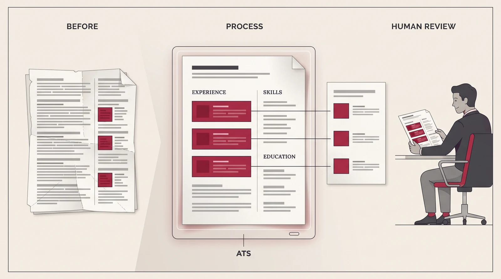
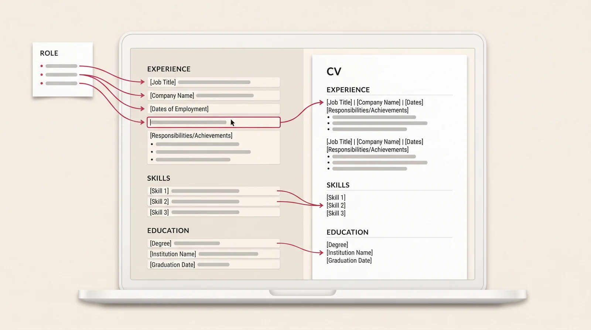

# CareerLens

### by NAVIFLARE

## Пройдите первый фильтр.

**Помощь с прохождением ATS и ИИ-фильтров HR, заполнением резюме и подготовкой откликов под вакансию.**

Мы создаём CareerLens, чтобы реальный подходящий опыт был понятнее и системе автоматического отбора, и человеку, который нанимает. Замысел объединяет пошаговое заполнение резюме, анализ вакансии, выбор релевантного опыта и подготовку проверенного отклика.

**Сейчас здесь только описание проекта и иллюстрации. Сам сервис не реализован.** В репозитории нет работающего приложения, установки, готовых интеграций или выпущенного продукта. Все перечисленные возможности — планируемые.

[English](README.md) · [Страница проекта](https://naviflare.com/ru/projects/careerlens/) · [Подробные возможности](docs/FEATURES.md) · [План развития](docs/ROADMAP.md)

*Иллюстрация замысла. Это не снимок работающего сервиса, не сертифицированный шаблон для ATS и не доказательство прохождения отбора.*

## Для чего нужен CareerLens

У человека может быть подходящий опыт, который теряется в длинном универсальном резюме. Бывает трудно сформулировать достижения, разобраться в требованиях вакансии или снова заполнить очередную анкету работодателя.

CareerLens должен помогать с этой работой:

- Разобраться, что требуется на конкретной позиции.
- Заполнить резюме с помощью пошаговых вопросов и проверяемых подсказок.
- Подготовить понятную структуру и показать реальную квалификацию для ATS и ИИ-отбора.
- Адаптировать подачу опыта под вакансию, сохранив настоящие факты.
- Подготовить сопроводительное письмо и поддерживаемые поля анкеты.
- Проверить точные документы и ответы перед отправкой.
- Следить за подготовленными, отправленными и подтверждёнными откликами.

Цель — помочь подходящему кандидату пройти первый отбор и дойти до рассмотрения человеком. Гарантировать прохождение любого фильтра или собеседование сервис не сможет.

## Планируемые возможности

| Возможность | Какую задачу должна решать |
| --- | --- |
| Пошаговое заполнение резюме | Начать с существующего резюме или профиля, дополнить опыт, даты, образование, навыки и достижения. |
| Помощь с формулировками | Понятнее описать настоящую работу; кандидат проверяет предложения и подтверждает сведения. |
| Подготовка к ATS | Проверить структуру, заголовки, читаемый текст и содержание экспортируемого документа. |
| Подготовка к ИИ-отбору | Связать требования вакансии с фактами из опыта, использовать подходящие термины там, где они правдивы. |
| Анализ вакансии | Отделить обязательные условия, полезные навыки, подтверждения и открытые вопросы. |
| Профессиональные фокусы | Выбрать подходящий опыт для разных направлений из одной личной истории. |
| Студия резюме | Собрать релевантное резюме, сохранив настоящие должности, даты и квалификацию. |
| Сопроводительные письма | Подготовить сообщение для конкретного отклика на основе проверенных фактов. |
| Помощь с анкетами | Повторно использовать подтверждённые сведения в поддерживаемых полях; личные решения остаются за человеком. |
| Проверка перед отправкой | Увидеть работодателя, вакансию, получателя, сообщение и точную версию резюме. |
| Направления поиска и история | Организовать разные страны или роли, списки вакансий и подтверждённые результаты откликов. |
| Изучение рынка | Показывать найденные вакансии с источниками, датами и ограничениями охвата. |
| Личная профессиональная история | Хранить полные факты отдельно от краткой информации для конкретного работодателя. |

## От вакансии до отклика

1. **Разберитесь в вакансии.** Изучите требования и вопросы, которые нужно уточнить.
2. **Заполните профиль.** Добавьте имеющиеся сведения, ответьте на вопросы, проверьте должности, даты и достижения.
3. **Выберите фокус.** Отметьте реальный опыт, который относится к выбранному направлению.
4. **Проверьте резюме.** Оцените структуру, формулировки, читаемость и подтверждения каждого утверждения.
5. **Подготовьте отклик.** Проверьте резюме, письмо и поддерживаемые поля анкеты.
6. **Примите решение об отправке.** Сохраните подтверждённый результат отдельно от подготовки и предположений.

*Концепция будущего интерфейса. Вымышленные поля поясняют процесс; это не работающая форма и не данные кандидата.*

## Как понимать помощь с ATS и ИИ-фильтрами

ATS — система работы с кандидатами. Извлечение сведений из документа в поля и оценка соответствия вакансии — разные этапы. CareerLens должен помогать подготовиться к обоим: дополнить сведения, проверить документ и яснее показать связь опыта с требованиями.

Примеры этих механизмов описаны в документации [Greenhouse о чтении резюме](https://support.greenhouse.io/hc/en-us/articles/200989175-Unsuccessful-resume-parse) и [Workable об ИИ-сопоставлении кандидатов с требованиями](https://help.workable.com/hc/en-us/articles/23685011706775-Using-the-AI-Screening-Assistant). Ссылки не означают, что CareerLens уже интегрирован с этими системами или одобрен ими.

Универсального сертификата «ATS пройден» не существует. Критерии работодателей различаются. Сервис не должен придумывать квалификацию, добавлять скрытые ключевые слова или выдавать отсутствие необходимых навыков за соответствие вакансии.

## Разные резюме — одна настоящая история

Профессиональный фокус — проверенная подборка опыта для определённого направления. Например, у вымышленного кандидата есть опыт работы на стройплощадке, координации команды и цифровых проектов. Для строительной роли важнее первые два блока, для цифровой — последние два. Настоящие должности и даты при этом не меняются.

- **Краткое резюме:** только необходимый для направления опыт.
- **Стандартное:** необходимый опыт и одобренные дополнения.
- **Расширенное:** более широкая подборка внутри направления; не весь личный архив.

То, что запрещено показывать, остаётся исключённым во всех разделах, письмах и версиях. Выборочную историю нужно обозначать, например заголовком «Избранный релевантный опыт». Подтверждение кандидатом означает, что он проверил факт, а не что сервис провёл независимую проверку биографии.

## Отправка под контролем человека

*Иллюстрация решения перед отправкой, а не работающей функции или состоявшегося отклика.*

Планируемые этапы: **Подготовлено → Проверено → Одобрено → Отправлено → Подтверждено**. Если доставку нельзя подтвердить, результат остаётся неизвестным до проверки.

Помощь с заполнением сокращает повторную работу, но финальная отправка остаётся за кандидатом. Любой будущий канал прямой отправки потребует явного включения и одобрения конкретного отклика. Изменение получателя, письма или резюме отменяет прежнее одобрение.

В первоначальный объём не входит универсальная автоматическая отправка на любые сайты вакансий. CAPTCHA, вход в аккаунт и личные или юридические заявления требуют участия человека. Открытая или заполненная форма не равна отправленному отклику.

## Конфиденциальность и факты

Планируется начинать с личного локального хранилища. Серверный режим, внешний ИИ и интеграции потребуют ясного объяснения передачи данных и разграничения доступа. Локальное хранение — направление проектирования, а не уже реализованная гарантия.

Профили, документы, поиски и одобрения разных кандидатов должны быть изолированы. Общими могут быть публичные вакансии. Уровень языка, право на работу и недостающие квалификации остаются неизвестными до проверки. Отчёты должны показывать реальные наблюдения и размер выборки, а не выдуманный процент успеха.

В этом репозитории нет личных резюме, базы кандидатов, паролей или документов откликов.

## Что опубликовано здесь

Описание проекта на двух языках, перечень возможностей, план развития и три иллюстрации. **Устанавливать и запускать пока нечего.**

В ТЗ рассматривается [career-ops](https://github.com/career-ops-hq/career-ops) как возможная основа реализации. CareerLens — отдельный проект NAVIFLARE, не официальный продукт career-ops и не реализованный форк. Исходный код стороннего приложения сюда не включён; условия и атрибуцию будущего использования нужно проверить на выбранной версии.

Лицензия приложения и проверенные инструкции установки появятся при публикации реализации. Происхождение и ограничения изображений указаны в [docs/MEDIA.md](docs/MEDIA.md).

В обсуждениях используйте вымышленные или обезличенные примеры. Не размещайте реальные резюме и частные сведения о работе в публичных issues. Контакт: [support@naviflare.com](mailto:support@naviflare.com).
